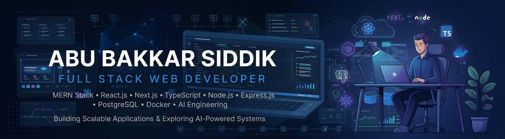
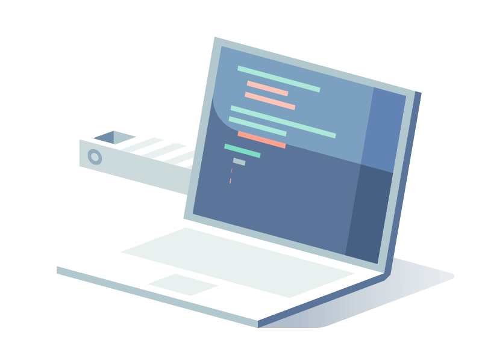

<h1 align="center">
  
</h1>

  <strong>Frontend Web Developer 👋 | Expert in JavaScript, React.js, Next.js, Tailwindcss|</strong>

 

 🌐 Connect with Me

  
  
  
  
  
  
  

### Talking about Personal Stuff:

- 🛠 &nbsp; I’m currently working with <strong>JavaScript, React,Node.js,Tailwind CSS</strong>
- 🚀 &nbsp; I’m currently exploring <strong>Golang, Blockchain, Rust, Solidity, Solana.</strong>
- 📫 &nbsp; Reach me out: <strong>abubakkar872884@gmail.com</strong>

### My Absolute Favorites:
- 💻 &nbsp; I love exploring new technologies and building cool stuff.
- 🍕 &nbsp; Meetups & Tech Events & Hackathons.

## 🔥 Languages, Frameworks & Tools

### 💻 Programming Languages

### 🎨 Frontend Development

### ⚙️ Backend Development

### 🗄️ Database & ORM

### 🏗️ Backend Engineering & Architecture
- Node.js Runtime & Asynchronous Programming
- Node.js Core Modules & HTTP Servers
- Express.js & REST API Development
- Scalable Backend Architecture & Clean Code
- Database Design & Relational Modeling
- SQL, Normalization, JOINs & Advanced Queries
- SaaS Architecture & Multi-Tenancy
- Authentication, Authorization & Workspace Management

### 📦 DevOps & Deployment

**Currently Exploring:**
- Docker Fundamentals, Images, Containers & Networking
- Docker Compose & Multi-Container Applications
- VPS Deployment, Nginx & CI/CD
- Production Backend Engineering

### 🤖 AI Engineering & AI Development
- LLM Application Development
- Prompt Engineering
- LangChain & Embeddings
- Vector Databases
- Retrieval-Augmented Generation (RAG)
- Semantic Search
- LangGraph & Tool Calling
- AI Agent Systems
- Production AI Integration & AI-Powered UX

---

## 📚 Currently Learning | Programming Hero Level 2

I'm continuously improving my software engineering skills and exploring advanced technologies.

| Learning Area | Topics |
|---|---|
| TypeScript | Advanced Types, Generics, OOP, Type Safety |
| Backend | Node.js Internals, Async Programming, HTTP Servers |
| Database | PostgreSQL, SQL, Normalization, JOINs |
| ORM | Drizzle ORM & Type-Safe Database Development |
| SaaS | Multi-Tenancy, Data Modeling, Workspace Management |
| DevOps | Docker, VPS, Nginx, CI/CD |
| AI Engineering | LangChain, RAG, LangGraph, AI Agents |

---

## 📊 GitHub Statistics & Analytics

---

## 🐍 Contribution Snake

---

### 💡 Building Today, Engineering for Tomorrow.

**Thanks for visiting my GitHub profile!** 🚀

